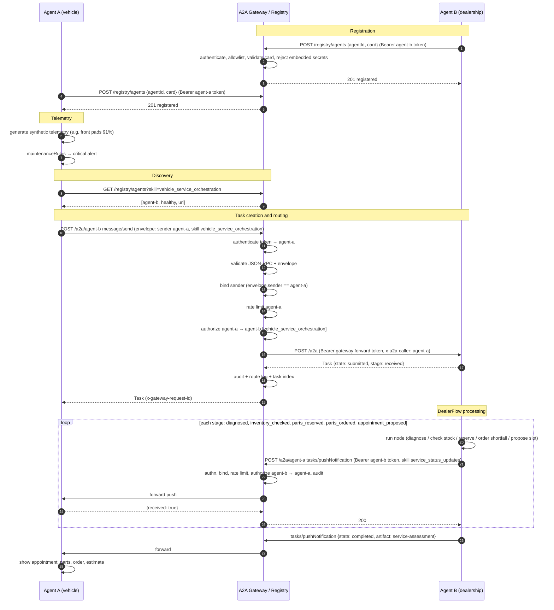
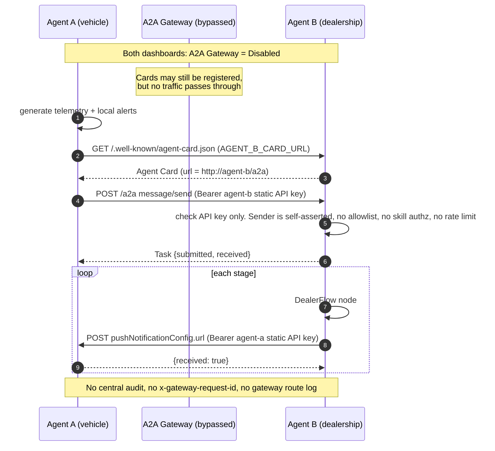

# A2A flow

## Gateway enabled



## Gateway disabled (direct A2A)



## Task lifecycle

| A2A `status.state` | `metadata.stage` | Meaning |
|---|---|---|
| submitted | received | Work order accepted |
| working | diagnosed | Findings and required parts determined |
| working | inventory_checked | Stock checked per part line |
| working | parts_reserved | Available stock reserved |
| working | parts_ordered | Purchase order placed for shortfalls (or "no order needed") |
| working | appointment_proposed | Mechanic + bay slot held |
| completed | completed | Artifact `service-assessment` attached |
| canceled | canceled | `tasks/cancel`; reservations, orders and held slots released |
| failed | failed | A DealerFlow node threw |

Parts orders progress independently: `placed → confirmed → in_transit`.

## Example payloads

All captured from a real run by `npm run examples`:

| Payload | File |
|---|---|
| Registration + discovery | `examples/00-registry-registration.json` |
| Telemetry service request (`message/send`) | `examples/01-telemetry-service-request.json` |
| Inventory check (status push) | `examples/02-inventory-check.json` |
| Parts reservation (status push) | `examples/03-parts-reservation.json` |
| Parts order creation (status push) | `examples/04-parts-order-creation.json` |
| Appointment proposal (status push) | `examples/05-appointment-proposal.json` |
| Task status (`tasks/get`) | `examples/06-task-status-update.json` |
| Completed task with artifact | `examples/07-task-completed-push.json` |
| Gateway denial of an unauthorized skill | `examples/08-gateway-denied-unauthorized-skill.json` |
| `cancel_task` request | `examples/09-cancel-task-request.json` |

Minimal `message/send` shape:

```json
{
  "jsonrpc": "2.0",
  "id": "rpc_…",
  "method": "message/send",
  "params": {
    "metadata": {
      "envelope": {
        "task_id": "task_…", "sender_agent_id": "agent-a", "recipient_agent_id": "agent-b",
        "skill": "vehicle_service_orchestration", "intent": "service_assessment_and_parts_order",
        "payload": { "vehicle": {…}, "telemetry": {…}, "detectedIssues": […], "preferences": {…} },
        "created_at": "2026-11-15T09:00:00.000Z", "status": "submitted", "correlation_id": "corr_…"
      }
    },
    "message": {
      "kind": "message", "role": "user", "messageId": "msg_…", "contextId": "corr_…", "taskId": "task_…",
      "parts": [
        { "kind": "text", "text": "service_assessment_and_parts_order (skill: vehicle_service_orchestration)" },
        { "kind": "data", "data": { "skill": "…", "intent": "…", "payload": {…} } }
      ]
    },
    "configuration": { "blocking": false, "pushNotificationConfig": { "url": "http://localhost:4001/a2a" } }
  }
}
```
